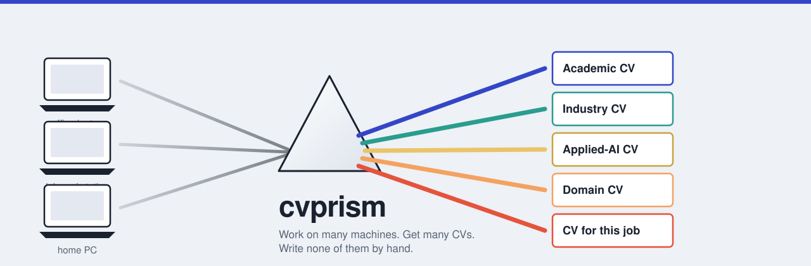
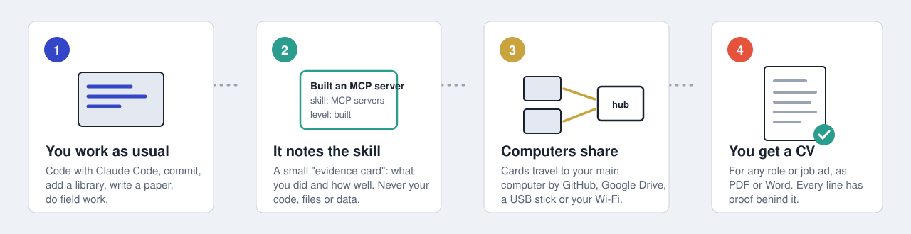
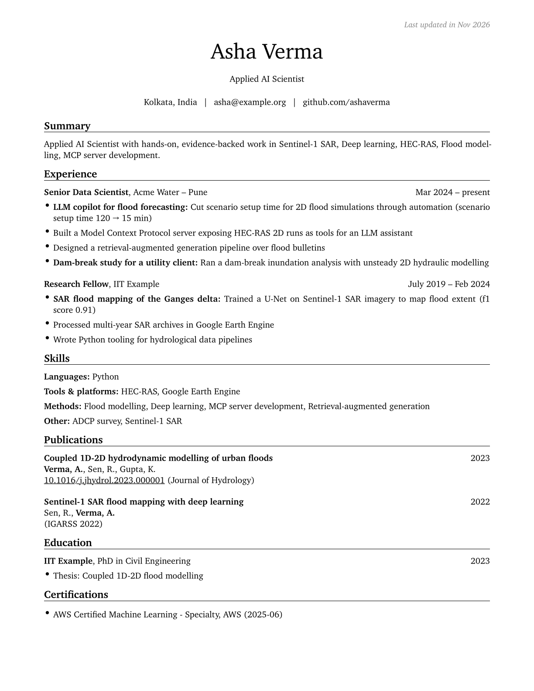
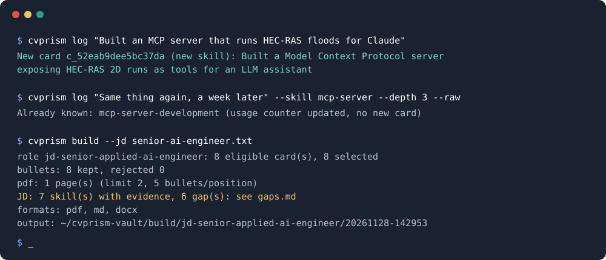
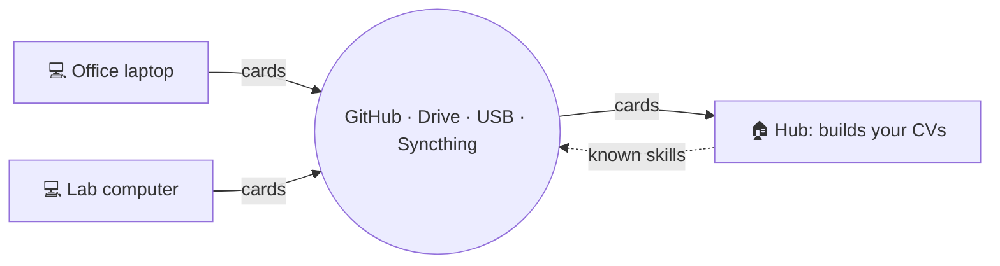

<p align="center">
  
</p>

<p align="center">
  <a href="https://github.com/sayantanonfire/cvprism/actions/workflows/ci.yml"></a>
  <a href="https://sayantanonfire.github.io/cvprism/"></a>
  
  
  <a href="LICENSE"></a>
</p>

<p align="center">
  <b>Your CV, kept up to date by the work you already do.</b><br>
  cvprism notices the skills you use every day, across all your computers, and turns them into<br>
  CVs for any role or job posting. Every line on the CV points to proof.
</p>

<p align="center">
  <a href="#-try-it-in-one-minute">Try it</a> ·
  <a href="#-how-it-works">How it works</a> ·
  <a href="#%EF%B8%8F-what-you-get">What you get</a> ·
  <a href="https://sayantanonfire.github.io/cvprism/">Documentation</a>
</p>

---

## 🤔 The problem

- **You learn something new almost every day:** a tool, a library, a method. Your CV gets updated once a year, from memory, and most of it is forgotten.
- **One CV can't speak to everyone.** A university, a tech company and an engineering consultancy each want different things first. Most people with mixed backgrounds keep several CVs and none of them is current.
- **Your work is spread out:** an office laptop, a lab computer, a home PC, maybe different Claude accounts.

cvprism fixes all three, and it never asks you to write a CV from scratch again.

## 🧭 How it works

<p align="center">
  
</p>

1. **You work as usual.** cvprism watches quietly: Claude Code sessions, git commits, new libraries in your projects. You can also tell it things directly: `cvprism log "Presented at EGU 2026"`.
2. **It writes a small evidence card** for each new skill or result: what you did, how deep, and any number you actually stated. It never stores your code, files, data or client names.
3. **Your computers share the cards** with one main computer (the hub), over a private GitHub repo, Google Drive / OneDrive / Dropbox, a USB stick or Syncthing. The design makes conflicts impossible.
4. **You ask for a CV** for a role (academic, industry, applied AI, your field) or paste a job posting. You get PDF, Word and Markdown, plus a report of what the job asks for that you can't yet prove.

## 🖼️ What you get

<table>
<tr>
<td width="52%" valign="top">

<p align="center"><sub>A real cvprism output for a made-up person (<code>cvprism demo</code>).</sub></p>
</td>
<td valign="top">

**Every line has a receipt.** Next to each CV, `evidence.md` shows the card behind every bullet:

```text
- Cut scenario setup time for 2D flood simulations
  through automation (scenario setup time 120 → 15 min)
  - c_9a59b3fedb34160f (2025-11-01, claude_session,
    depth 4)
```

**Numbers can't be invented.** If a drafted line mentions a number that isn't in the evidence, code removes it and lists it in `rejected.md`.

**Honest gap reports.** Tailor to a job and you also get `gaps.md`:

```text
## No evidence
- Hydraulic modelling (related evidence:
  Flood modelling, HEC-RAS)
- Kubernetes
- PyTorch
## Thin evidence (depth 1: used only)
- Docker
```

</td>
</tr>
</table>

## 🚀 Try it in one minute

You need [Python 3.10 or newer](https://www.python.org/downloads/) (3.12+ for PDF output). On Windows, tick **"Add python.exe to PATH"** when installing.

```bash
git clone https://github.com/sayantanonfire/cvprism.git
cd cvprism
./start.sh                       # Windows: start.bat
```

Answer four questions (or run `cvprism init --web` to answer them in your browser). Then see what cvprism makes, without setting anything else up:

```bash
cvprism demo --out cvprism-demo
```

This builds four CVs for a made-up person in about ten seconds, completely offline.

<p align="center">
  
</p>

## 🛠️ Everyday use

| I want to… | Command |
| --- | --- |
| Start from my LinkedIn profile | `cvprism import-linkedin Basic_LinkedInDataExport.zip` |
| Start from my old CV | `cvprism import-cv old_cv.docx` |
| Add my publications | `cvprism import-orcid 0000-0002-1825-0097` |
| Record something by hand | `cvprism log "Led a 10-day field survey"` (or `/cv-log` inside Claude Code) |
| Capture automatically from now on | `cvprism install` (undo any time with `cvprism uninstall`) |
| Sync my computers | `cvprism sync` (the background agent also does this every 15 minutes) |
| Build a CV for a role | `cvprism build --role academic` |
| Build a CV for a job posting | `cvprism build --jd posting.txt` or a URL |
| Check that everything works | `cvprism doctor` |

Five starter roles are included: `academic`, `industry-ds`, `applied-ai`, `hydrodynamics`, `geospatial`. Adding your own means copying one small text file. See [Building CVs](https://sayantanonfire.github.io/cvprism/guide/building-cvs/).

## 💻 Several computers



Each computer only ever adds to its own files, and each card's ID comes from its content, so the same achievement arriving twice is stored once. Offline? Cards wait and go out later. Lost the hub? Promote another computer and it rebuilds everything. Details: [Several computers](https://sayantanonfire.github.io/cvprism/guide/multi-device/).

## 🔒 Privacy

| cvprism records | cvprism never records |
| --- | --- |
| Skill and tool names (`PyTorch`, `HEC-RAS`) | Your code, files, notebooks or data |
| What you did, in one sentence | Client, employer or colleague names (you choose public-safe project names) |
| How deep you went (used → built → published) | Passwords, keys, tokens; a secret scanner drops any card that contains one |
| Numbers **you** stated | Full chat transcripts (only a stripped-down summary is ever read) |

Everything is plain text files you own: no database, no server, no account. The code is public and your vault is a separate private folder. Full details: [Security & privacy](docs/SECURITY_PRIVACY.md).

## ❓ FAQ

<details>
<summary><b>Do I need Claude Code?</b></summary>

For automatic capture, yes: cvprism reads what you did in Claude Code sessions. Without it, manual logging (`cvprism log --raw`), git and folder capture, imports and CV builds (`--no-llm`) all still work.
</details>

<details>
<summary><b>Does it make things up?</b></summary>

No. Every bullet must cite at least one evidence card, and every number must be traceable to that evidence or to a fact you wrote yourself. This is checked by code, not by asking an AI nicely. Anything that fails is removed and listed in <code>rejected.md</code>.
</details>

<details>
<summary><b>Will it fill my CV with trivial things?</b></summary>

No. A card is created only for a new skill, a deeper level of a known skill, a new measurable result, or non-code work like papers and talks. Using Python for the hundredth time just updates a counter.
</details>

<details>
<summary><b>What does it cost?</b></summary>

cvprism is free and open source (Apache-2.0). AI steps use your own Claude Code login. You can build CVs with no AI at all using <code>--no-llm</code>.
</details>

<details>
<summary><b>Can I edit the result?</b></summary>

Yes. Each build includes the Markdown, a Word file, and the RenderCV source (<code>cv.rendercv.yaml</code>) for layout tweaks. Your evidence and profile are plain YAML/JSON files you can read and edit.
</details>

---

## 📚 Documentation

| | |
| --- | --- |
| [Getting started](https://sayantanonfire.github.io/cvprism/guide/getting-started/) | Install, import, capture, build |
| [CLI reference](https://sayantanonfire.github.io/cvprism/guide/cli/) | Every command and option |
| [Architecture](docs/ARCHITECTURE.md) | Components, data flow, failure modes |
| [File formats](docs/SCHEMA.md) · [Sync protocol](docs/SYNC.md) | For people building on cvprism |
| [Decision records](docs/adr/) | Why things are the way they are |
| [Changelog](CHANGELOG.md) · [Roadmap](docs/ROADMAP.md) | What's done and what's next |

## 🤝 Contributing

New role profiles, skill names, sync adapters and translations are all welcome, and most need no Python. Start with [CONTRIBUTING.md](CONTRIBUTING.md). Please report security issues privately as described in [SECURITY.md](SECURITY.md).

## 🙏 Built with

[RenderCV](https://github.com/rendercv/rendercv) and [Typst](https://typst.app) for typesetting, [Claude Code](https://claude.com/claude-code) for understanding your work, [Typer](https://typer.tiangolo.com), [watchdog](https://github.com/gorakhargosh/watchdog) and [python-docx](https://github.com/python-openxml/python-docx).

## 📜 License

[Apache-2.0](LICENSE). Your career data is yours: it never leaves the places you choose.
