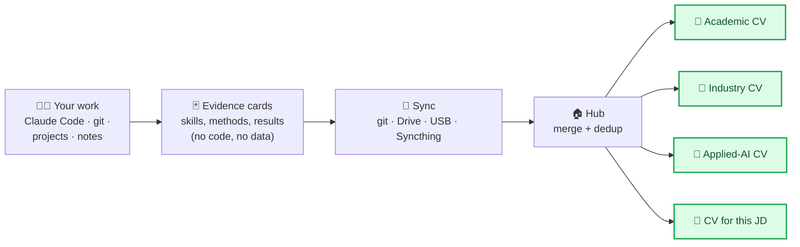

# cvprism

**Work on many machines. Get many CVs. Write none of them by hand.**

cvprism quietly records the skills, methods and results that show up in your everyday work: Claude Code sessions, git commits, new dependencies, plus one-line notes you add. It deduplicates what it already knows, syncs everything from all your computers to one hub, and compiles CVs tailored to a role or a job description. Every bullet cites the evidence behind it.

> 🚧 **Status: design phase (Phase 0).** Nothing is installable yet. The quick start below is aspirational. Read the [architecture](docs/ARCHITECTURE.md) and [roadmap](docs/ROADMAP.md), and open an issue with feedback.

## 🔍 The problem

- You learn something new nearly every day: a tool, an API, a model, a method. Your CV gets updated once a year, from memory.
- Multidisciplinary people have it worst. One document can't speak to academic, industry, applied-AI *and* domain audiences (e.g. hydrodynamic modelling, geospatial) at once.
- Your work is spread across a work laptop, a lab workstation and a home PC, each possibly with a different Claude account.

## 🌈 How it works



| Principle | What it means |
| --- | --- |
| Evidence, not adjectives | Every CV bullet cites ≥ 1 card. Numbers that aren't in the evidence are rejected by code, not by a prompt |
| Methodology, never content | Cards hold skill names, methods and stated results. Never code, data, file contents or client names |
| Plain files | JSONL + YAML + JSON. No database, no server, no account lock-in |
| Any transport | Private git repo, Google Drive/OneDrive/Dropbox folder, USB stick, Syncthing. Use several at once |
| Conflict-free by design | Each device appends only to its own inbox. Card IDs are content hashes, so merging is a union |

## ⚡ Quick start (aspirational)

```bash
git clone https://github.com/sayantanonfire/cvprism.git
cd cvprism
./start.sh            # Windows: start.bat
# wizard: device name → hub or spoke → folders to watch → where the vault syncs
```

Then just work. Afterwards:

```bash
cvprism log "Ran field ADCP survey on the Hooghly estuary"   # anything non-code
cvprism status                                               # cards, backlog, adapters
cvprism build --role applied-ai                              # on the hub → PDF + DOCX + MD
cvprism build --jd job.txt                                   # tailored to a posting, with a gap report
```

Adding another computer means running `start.sh` there and choosing **spoke**.

## 🗺️ Documentation

| Doc | |
| --- | --- |
| [Architecture](docs/ARCHITECTURE.md) | Components, data flow, failure modes, open questions |
| [Schema](docs/SCHEMA.md) | Cards, registry, device config, profile, role profiles |
| [Sync](docs/SYNC.md) | Protocol, adapters, offline and conflict scenarios |
| [Security & privacy](docs/SECURITY_PRIVACY.md) | What is and isn't captured, redaction |
| [Roadmap](docs/ROADMAP.md) | M1–M6 with acceptance criteria |
| [ADRs](docs/adr/) | Every non-obvious design decision |

## 🤝 Contributing

cvprism is designed to be extended without touching the core:

- **Add a role:** copy a YAML file in [`roles/`](roles/).
- **Add a sync adapter:** one Python module implementing `push`, `pull` and `status` ([ADR-005](docs/adr/ADR-005-adapter-interface.md)).
- **Add a CV template:** see [`templates/`](templates/).

During Phase 0 the most valuable contribution is critique: open an issue against any ADR. Your vault (your career data) always lives in a **separate private location** and never in a fork of this repository.

## 📜 License

[Apache-2.0](LICENSE)
