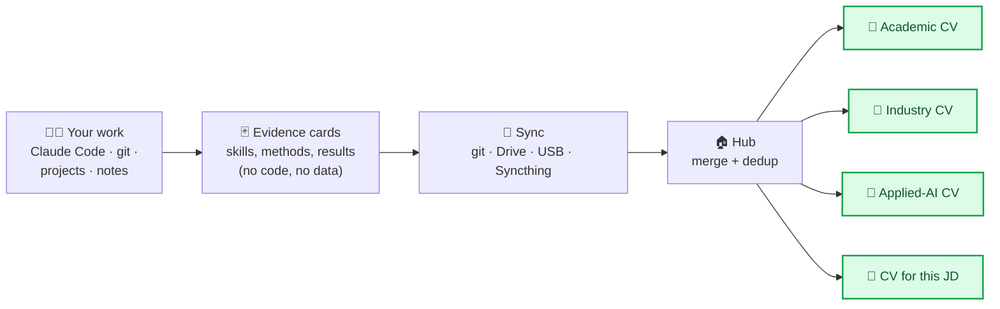

# cvprism

**Work on many machines. Get many CVs. Write none of them by hand.**

cvprism quietly records the skills, methods and results that show up in your everyday work: Claude Code sessions, git commits, new dependencies, plus one-line notes you add. It deduplicates what it already knows, syncs everything from all your computers to one hub, and compiles CVs tailored to a role or a job description. Every bullet cites the evidence behind it.

> **v1.0.** Capture, multi-device sync, evidence-cited CV builds (PDF, DOCX, Markdown), job-description tailoring and market intel. Documentation: **[sayantanonfire.github.io/cvprism](https://sayantanonfire.github.io/cvprism/)**. Try it in 30 seconds with `cvprism demo`.

## 🔍 The problem

- You learn something new nearly every day: a tool, an API, a model, a method. Your CV gets updated once a year, from memory.
- Multidisciplinary people have it worst. One document can't speak to academic, industry, applied-AI *and* domain audiences (e.g. hydrodynamic modelling, geospatial) at once.
- Your work is spread across a work laptop, a lab workstation and a home PC, each possibly with a different Claude account.

## 🌈 How it works



| Principle | What it means |
| --- | --- |
| Evidence, not adjectives | Every CV bullet cites ≥ 1 card. Numbers that aren't in the evidence are rejected by code, not by a prompt |
| Methodology, never content | Cards hold skill names, methods and stated results. Never code, data, file contents or client names |
| Plain files | JSONL + YAML + JSON. No database, no server, no account lock-in |
| Any transport | Private git repo, Google Drive/OneDrive/Dropbox folder, USB stick, Syncthing. Use several at once |
| Conflict-free by design | Each device appends only to its own inbox. Card IDs are content hashes, so merging is a union |

## ⚡ Quick start

```bash
git clone https://github.com/sayantanonfire/cvprism.git
cd cvprism
./start.sh            # Windows: start.bat
# wizard: device name → hub or spoke → folders to watch → where the vault syncs
```

Works today (M1):

```bash
cvprism log "Built an MCP server exposing HEC-RAS runs as tools"     # Claude turns it into a market-phrased card
cvprism log --raw "Led a 10-day ADCP field survey" --skill adcp-survey --depth 4 --work   # no LLM needed
cvprism log --raw "Cut inference latency" --skill onnx --depth 4 --result "latency:-40:%"
cvprism status        # cards, month files, adapters
cvprism show          # recent cards
cvprism doctor        # environment check
cvprism install       # Claude Code SessionEnd hook, git hook dispatcher, /cv-log skill, login agent
cvprism install --dry-run   # see every change first; `cvprism uninstall` reverts all of it
```

Logging the same thing twice creates no new card, only a usage count. A higher depth or a new result creates a new card. Metrics you didn't state are never kept.

Build CVs on the hub:

```bash
cvprism roles                                   # academic, industry-ds, applied-ai, hydrodynamics, geospatial + yours
cvprism build --role applied-ai                 # → vault/build/applied-ai/<timestamp>/cv.pdf, cv.docx, cv.md
cvprism build --role academic --no-llm          # card text only, no Claude call
cvprism import-orcid 0000-0002-1825-0097        # pull publications into pubs.bib
cvprism build --jd posting.txt                  # tailored to a job posting (file or URL) + gaps.md
cvprism market add applied-ai posting.txt       # save postings you care about...
cvprism market extract applied-ai               # ...and mirror their recurring phrases in future builds
```

Every build also writes `evidence.md` (each bullet → the cards it cites) and `rejected.md` (drafted claims the honesty gate removed because no evidence supported them).

Adding another computer means running `start.sh` there and choosing **spoke**:

```bash
# hub (your main machine)
cvprism init --name home-pc --role hub --vault ~/cvprism-vault --adapter git:git@github.com:me/cvprism-vault.git --yes
cvprism sync
# every other machine
cvprism init --name office-01 --role spoke --adapter git:git@github.com:me/cvprism-vault.git --yes
cvprism sync          # the background agent also does this every 15 min and when a USB drop-box is plugged in
```

## 🗺️ Documentation

| Doc | |
| --- | --- |
| [Architecture](docs/ARCHITECTURE.md) | Components, data flow, failure modes, open questions |
| [Schema](docs/SCHEMA.md) | Cards, registry, device config, profile, role profiles |
| [Sync](docs/SYNC.md) | Protocol, adapters, offline and conflict scenarios |
| [Security & privacy](docs/SECURITY_PRIVACY.md) | What is and isn't captured, redaction |
| [Roadmap](docs/ROADMAP.md) | M1–M6 with acceptance criteria |
| [ADRs](docs/adr/) | Every non-obvious design decision |

## 🤝 Contributing

See [CONTRIBUTING.md](CONTRIBUTING.md).


cvprism is designed to be extended without touching the core:

- **Add a role:** copy a YAML file in [`roles/`](roles/).
- **Add a sync adapter:** one Python module implementing `push`, `pull` and `status` ([ADR-005](docs/adr/ADR-005-adapter-interface.md)).
- **Add a CV template:** see [`templates/`](templates/).

Design critique is welcome too: open an issue against any ADR. Your vault (your career data) always lives in a **separate private location** and never in a fork of this repository.

## 📜 License

[Apache-2.0](LICENSE)
