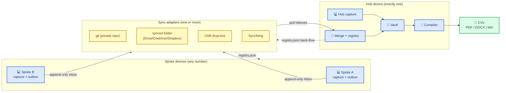
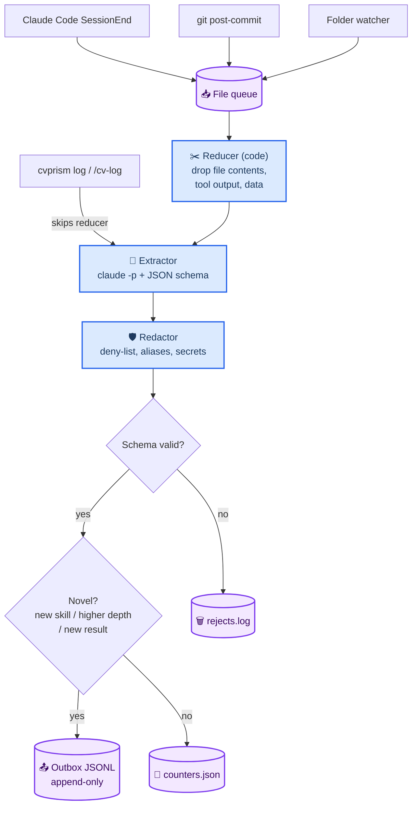
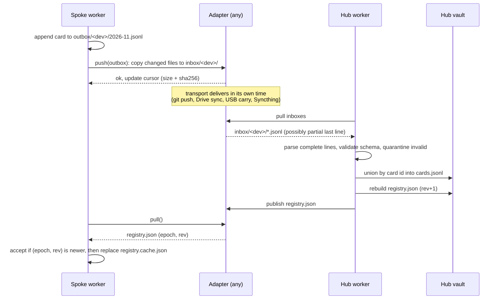
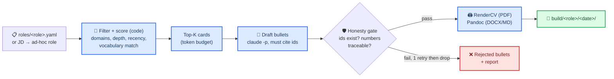
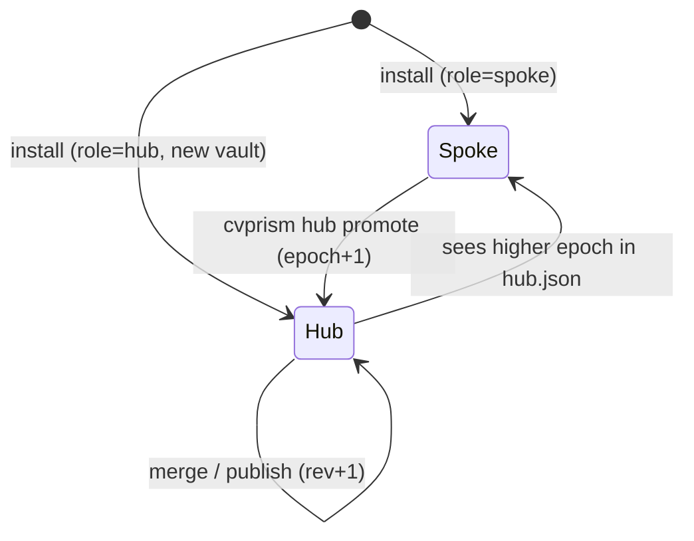

# cvprism Architecture

> Status: **Phase 0 draft for review**. Nothing here is implemented yet. Normative words (MUST, SHOULD, MAY) follow RFC 2119.

cvprism turns ordinary work spread over several computers into evidence cards. It syncs them to one hub machine and builds CVs for specific roles from them. Every CV bullet traces back to at least one card.

Companion documents:

| Document | Covers |
| --- | --- |
| [SCHEMA.md](SCHEMA.md) | Exact file formats and JSON Schemas |
| [SYNC.md](SYNC.md) | Sync protocol, adapters, offline and conflict scenarios |
| [SECURITY_PRIVACY.md](SECURITY_PRIVACY.md) | What is and isn't captured, redaction |
| [ROADMAP.md](ROADMAP.md) | Milestones and acceptance criteria |
| [adr/](adr/) | Architecture Decision Records |

---

## 🎯 Goals and non-goals

**Goals**

1. Capture methodology, skills, tools, techniques and measurable results continuously, with no user effort beyond an optional one-line log.
2. Keep state in plain, human-readable files. No database, no server, no dependency on any Claude account.
3. Sync from any number of devices into one hub over interchangeable transports, without conflicts.
4. Compile tailored CVs (academic, industry, applied-AI, domain) where every claim cites evidence.
5. Stay cheap: deterministic code does filtering and dedup, and the LLM sees only small, pre-filtered inputs.

**Non-goals (v1)**

- Capturing raw data, file contents, source code or client data. This is a hard rule (see [SECURITY_PRIVACY.md](SECURITY_PRIVACY.md)).
- Real-time sync, multi-user vaults, a hosted service or a GUI CV editor.
- A native LAN server (`cvprism hub serve` is on the post-v1 roadmap; see [ADR-006](adr/ADR-006-syncthing-not-custom-lan.md)).
- Writing our own CV typesetter ([ADR-010](adr/ADR-010-renderer.md)).

---

## 🧭 System context

---

## 🧱 Components

Each component maps to one subpackage of `cvprism/`.

| Component | Package | Runs on | Responsibility |
| --- | --- | --- | --- |
| Installer and wizard | `start.sh`, `start.bat`, `cvprism/setup` | all | Create the venv, run the first-run wizard, register hooks and the login service |
| Capture: Claude Code hook | `capture/hooks` | all | `SessionEnd` hook that **enqueues** a job. It never runs the extraction inline |
| Capture: git hook | `capture/hooks` | all | Global `post-commit` dispatcher that chains to repo-local hooks ([ADR-008](adr/ADR-008-git-hooks-chaining.md)) and enqueues commit metadata |
| Capture: watcher | `capture/watcher` | all | Watches opted-in paths for tech-signal files (manifests, notebooks, `SKILL.md`, model configs) and enqueues **diffs of dependency names only** |
| Capture: manual | `capture/manual`, `skills/cv-log` | all | `cvprism log "<line>"` and the `/cv-log` skill |
| Job queue and worker | `capture/queue` | all | A durable file-based queue (`~/.cvprism/queue/`) drained by the background service |
| Reducer | `capture/reduce` | all | Turns raw signals (transcript, commit, diff) into a small, sanitised digest **in code** before any LLM call |
| Extractor | `capture/extract` | all | Runs `claude -p` with a JSON-schema-constrained prompt over the digest and returns candidate cards |
| Redactor | `capture/redact` | all | Applies the user's deny-lists, project aliases and secret scanners to candidate cards |
| Novelty filter | `novelty/` | all | Compares candidates with the local registry cache and emits a card or bumps a counter |
| Outbox | `sync/outbox` | all | Append-only per-device JSONL files, with per-adapter replication cursors |
| Sync adapters | `sync/adapters/*` | all | `push(outbox)`, `pull() -> registry`, `status()` for git, gdrive, usb, syncthing and local |
| Hub merge | `hub/merge` | hub | Unions all inboxes into `cards.jsonl`, validates and quarantines, rebuilds the registry |
| Registry publisher | `hub/publish` | hub | Writes `registry.json` back out through every adapter |
| Compiler | `compile/` | hub | Role and JD filtering, scoring, bullet rewriting with citations, honesty gate, rendering |
| Market intel (M5) | `compile/market` | hub | Extracts recurring phrases per role into `vault/market/<role>.json` |

### Local state vs vault

Two storage locations are kept strictly apart.

| Location | Contents | Synced? |
| --- | --- | --- |
| `~/.cvprism/` (platform data dir, via `platformdirs`) | `device.yaml`, `outbox/<device-id>/*.jsonl`, `queue/`, `counters.json`, `registry.cache.json`, adapter cursors, logs | **No**. Only the outbox is replicated, by adapters |
| Vault (hub: a real directory; spokes: reached only through adapters) | `inbox/<device-id>/`, `cards.jsonl`, `registry.json`, `profile.yaml`, `roles/`, `market/`, `hub.json`, `vault.json` | Yes, through adapters |

The outbox lives on local disk first, so a card exists durably on the device that captured it before any transport is involved. Adapters only ever *copy* outbox files into `inbox/<device-id>/` at the transport. Spokes never hold a full vault. That keeps the career history of a whole vault off a lost laptop or USB stick, except where the user chooses a full-vault transport.

---

## 🔄 Data flow

### Capture to card (every device)

Key properties:

- **Hooks only enqueue.** A Claude Code `SessionEnd` hook MUST return within milliseconds. Extraction runs later in the worker. This also stops the extractor's own `claude -p` session from triggering capture recursively: the worker sets `CVPRISM_EXTRACTING=1`, and the hook exits immediately when it sees that variable.
- **The reducer runs before the LLM.** The digest keeps user prompts (truncated), tool *names*, file *extensions*, package names, command verbs and commit subjects. It drops file contents, tool outputs, diffs and data. This is both the privacy boundary and the token budget, capped by `extraction.max_input_tokens` (default 6k).
- **Manual entries** go straight to the extractor, which normalises them into the market-facing card form. With `--raw` they skip the LLM entirely, so `cvprism log` works offline and with no Claude installed.
- **Missing metrics are never invented.** If the text implies a result but gives no number, `r` is `null` and `flags` contains `needs_metric`. `cvprism review` lists these for the user to fill in.

### Sync and merge

### Compile (hub)

The honesty gate is deterministic code, not a prompt instruction ([ADR-009](adr/ADR-009-honesty-gate.md)). It:

1. Rejects any bullet without `[c_…]` citations, or citing IDs not in `cards.jsonl`.
2. Extracts every number (including `%`, `x`, ranges and written-out numbers) from the bullet. Each one MUST appear in a cited card's `r` or in `profile.yaml`. Otherwise the bullet is rejected.
3. Writes `build/<role>/<date>/evidence.md`, a bullet-to-card trace you can audit before sending a CV.

---

## 🧩 Topology and hub lifecycle

- Exactly one hub per vault. Its identity lives in `vault/hub.json` as `{hub_device_id, epoch}`.
- `cvprism hub promote` on a new device increments `epoch` and becomes authoritative for hub-owned files. Spokes accept `registry.json` only from the highest `(epoch, rev)`.
- A demoted hub that comes back online sees a higher epoch in `hub.json` and stops writing hub-owned files. It keeps its own inbox, so no data is lost.
- Spokes never talk to each other, and a spoke never writes outside `inbox/<own-device-id>/` on any transport.

---

## 💥 Failure modes

| # | Failure | Effect | Mitigation |
| --- | --- | --- | --- |
| F1 | No adapter reachable (offline, no USB) | Cards accumulate locally | The outbox *is* durable storage. Cursors push everything once any adapter returns. `cvprism status` shows the backlog |
| F2 | Partial file at the transport (Drive mid-upload, USB yanked) | Last line truncated | Writers always end lines with `\n`. The hub ignores an unterminated last line and gets it on the next pull |
| F3 | Synced-folder conflict copy (`2026-11 (1).jsonl`, `…conflicted copy…`) | Duplicate files | The hub globs and unions *all* `*.jsonl` in each inbox dir. Content-hash IDs make the union idempotent |
| F4 | Same achievement captured on two devices | Duplicate cards | Identical canonical fields give the same `id` and are deduped at merge. Near-duplicates (different wording, same facts) are caught by the canonical-field ID because free text is excluded ([ADR-002](adr/ADR-002-content-hash-ids.md)) |
| F5 | Two devices both believe they are the hub (split brain) | Competing `cards.jsonl` / `registry.json` | Epoch in `hub.json`. Lower-epoch hub output is ignored and the lower-epoch hub self-demotes. `cards.jsonl` is always reproducible from the inboxes, so nothing is lost |
| F6 | Stale registry on a spoke | Spoke emits a card the hub already knows | Harmless. The hub dedups by ID and the novelty check is repeated at merge |
| F7 | Extractor returns invalid JSON / hallucinated metric | Bad card | JSON-schema validation and retry once, then reject. Metrics must quote a number present in the digest, otherwise they are nulled and flagged |
| F8 | `claude` CLI missing or not logged in | No auto-extraction | Jobs stay queued (TTL 30 days), `cvprism doctor` reports it, and manual `--raw` logging still works |
| F9 | SessionEnd hook recursion | Infinite extraction loop | `CVPRISM_EXTRACTING=1` guard, plus a queue dedup key per transcript path |
| F10 | Transcript deleted before the worker runs (Claude Code cleanup) | Lost session | The worker runs within minutes. Jobs with a missing transcript are dropped and logged. Transcripts are never copied (privacy) |
| F11 | Global `core.hooksPath` hides repo-local hooks | Breaks user tooling (husky, pre-commit) | The dispatcher chains to `$GIT_DIR/hooks/<name>` and to any previous global path ([ADR-008](adr/ADR-008-git-hooks-chaining.md)) |
| F12 | Vault accidentally committed to the public code repo | Privacy leak | The wizard refuses vault paths inside a cvprism checkout. `vault.json` carries a `vault_id`. The code repo `.gitignore` excludes `vault/` |
| F13 | Two vaults on one transport (two users or test vault) | Cross-contamination | Every adapter checks `vault_id` in the transport's `vault.json` before reading or writing |
| F14 | Clock skew between devices | Out-of-order timestamps | Correctness never depends on time. Month files use device-local capture time. Ordering at the hub is by `(t, id)` for display only |
| F15 | Secret or client name leaks into a card | Privacy | Redactor deny-list, secret regexes and entropy check before write. Optional `review_mode` holds cards in `pending/` until approved |

---

## ⚙️ Runtime and platform

| Concern | Choice |
| --- | --- |
| Language | Python ≥ 3.10, one venv in the platform data dir (never on the USB stick) |
| CLI | `typer` |
| File watching | `watchdog` |
| Schemas | `jsonschema` (draft 2020-12); the schemas in `cvprism/schemas/` are the single source |
| YAML | `ruamel.yaml` (round-trip, preserves user comments) |
| Login service | Windows: per-user `HKCU\...\Run` value (`pythonw -m cvprism agent`, no admin); macOS: `launchd` LaunchAgent; Linux: `systemd --user` unit, falling back to an XDG autostart `.desktop` file |
| LLM | `claude -p --output-format json` invoked by subprocess ([ADR-007](adr/ADR-007-extraction-via-claude-cli.md)) |
| Rendering | RenderCV for PDF, Pandoc for DOCX/MD ([ADR-010](adr/ADR-010-renderer.md)) |

---

## ❓ Open questions

These need your decision before or during M1/M2. Each one names the default I would pick.

> **2026-11-27:** M1 started with every default below adopted provisionally (owner said "go ahead"). Any of them can still be overturned. Each is isolated behind config or a single module.

1. **Counters on the hub.** Should per-skill usage counters (`count`, `last_seen`) reach the hub? They make good evidence ("used daily for 14 months") but are mutable. *Default:* each device appends a monthly rollup line `{"k":"usage", …}` to its inbox, which keeps it append-only.
2. **Review before write.** Should auto-captured cards go straight to the outbox, or wait in `pending/` until approved? *Default:* straight through, with `review_mode: true` available. Weekly `cvprism review` digest.
3. **Extraction model and cost.** `claude -p` uses whichever account is logged in on each device. Should we pin a cheaper model (e.g. Haiku) for extraction via `--model`? *Default:* yes, with `extraction.model` configurable.
4. **Wizard form.** TUI or a local browser page for the first run? *Default:* TUI in M1 (works over SSH, no server), browser page in M6.
5. **Package distribution.** Publish to PyPI as `cvprism` (claim the name now) and have `start.sh` install from the local checkout or USB? *Default:* yes to both.
6. **Skill taxonomy seed.** Should we seed the registry with an external taxonomy (ESCO, O*NET, Lightcast open skills) for alias normalisation, or grow organically? *Default:* small hand-curated seed (~300 tech and science skills) plus organic growth. Check licences before adopting ESCO/Lightcast.
7. **Market intel source (M5).** Scraping job boards raises terms-of-service problems. *Default:* the user pastes or saves postings into `vault/market/raw/`, and cvprism extracts from those. Official APIs come later.
8. **Full-vault transports.** Should spokes ever receive `cards.jsonl` (e.g. to build a CV away from the hub)? *Default:* no in v1. Only the hub compiles, which keeps the "lost laptop" exposure small.
9. **Card language.** English only in v1? *Default:* yes. Cards carry a `lang` field reserved for later.
10. **Encryption at rest on transports.** Should inbox files on Drive/USB be encrypted (e.g. `age`)? *Default:* not in v1. Documented as a known exposure, optional `age` encryption in M6.
11. **Licence.** The repo has Apache-2.0. RenderCV is MIT, and Pandoc is GPL but invoked as a separate binary, not linked. Confirm Apache-2.0 is intended.
