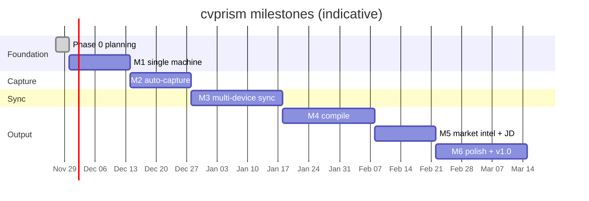

# cvprism Roadmap

> Status: **Phase 0 draft**. Each milestone is **done** only when every acceptance criterion passes as an automated test on Windows, macOS and Linux CI, unless marked *(manual)*.

---

## 🧱 M1: Single machine ✅

> Done 2026-11-27. All automated criteria pass in CI (Ubuntu, macOS, Windows × Python 3.10/3.13, plus start-script bootstrap jobs).

**Scope:** `start.sh`/`start.bat`, venv bootstrap, TUI wizard (device name, role, vault path), vault template, `cvprism log`, card schema and ID, local registry, novelty filter, counters, `cvprism status`, `cvprism doctor`.

**Acceptance criteria**

1. On a clean machine with Python ≥ 3.10, `./start.sh` (or `start.bat`) creates the venv in the platform data dir and launches the wizard. Finished in < 2 min. *(manual on 3 OSes, plus scripted CI)*
2. `cvprism log --raw "Built an MCP server exposing HEC-RAS runs" --skill mcp-server-development --depth 3` writes exactly one schema-valid line to `outbox/<dev>/YYYY-MM.jsonl`.
3. Running the same command again writes **no** card and increments `counters.json[mcp-server-development].n`.
4. The same command with `--depth 4` writes a new `depth` card. With `--result "latency:-40:%"` it writes a new `result` card.
5. Card IDs are stable across OSes and Python versions (golden-file test over 50 canonical inputs).
6. The wizard refuses a vault path inside the code checkout.
7. `cvprism log "<text>"` (LLM mode) produces a market-phrased card when `claude` is available, and falls back to `--raw` with a warning when it is not.

## 🛰️ M2: Auto-capture 🟡

> Implemented 2026-11-27. Criteria 1–6 are automated and passing. Criterion 7 (a real session plus a reboot) needs the owner to run `cvprism install` on a real machine.

**Scope:** Claude Code `SessionEnd` hook installer, global git hook dispatcher with chaining, watcher for opted-in paths, file queue and worker, reducer, extractor prompt and schema, redactor, login service per OS, `/cv-log` skill.

**Acceptance criteria**

1. Installing registers the `SessionEnd` hook in user-level Claude Code settings **without** clobbering existing hooks (merge test on 3 fixture settings files). Uninstall restores the original exactly.
2. The hook returns in < 200 ms and only enqueues (timed test).
3. The fixture transcript `tests/fixtures/sessions/mcp_build.jsonl` produces ≥ 1 card that has `s ∋ mcp-server-development`, `d ≥ 3`, no metric invented (`r == null`, `needs_metric` set), and passes the redaction test (fixture contains a fake AWS key and a client name, and neither appears in the output).
4. A repo with an existing `.git/hooks/post-commit` (and a husky repo) still runs its own hook after the global dispatcher is installed.
5. Adding `torch` to a watched `requirements.txt` yields one queued signal after the debounce. Editing a file under an `ignore` glob yields none.
6. No recursion: an extraction run produces zero new queue jobs.
7. *(manual)* A real 30-min Claude Code session yields a sensible card with no user action, and the background service survives a reboot.

## 🔁 M3: Multi-device sync ✅

> Done 2026-11-27. Five adapters (local, gdrive, usb, syncthing, git) pass one shared conformance suite. The two-spoke/two-adapter headline test passes. USB flush on mount is wired into the agent; criterion 6 (real hardware) is manual.

**Scope:** Outbox cursors, adapters `local`, `git`, `gdrive`, `usb`; hub merge, quarantine, registry rebuild and publish; `hub.json` epochs; `cvprism sync`, `cvprism hub merge|promote|rebuild`; `suppress`, `purge`.

**Acceptance criteria**

1. **Headline:** two simulated spokes (A via git, B via gdrive folder) plus one card captured on both, merged on the hub, give `cards.jsonl` with every card exactly once. Both spokes then receive the new registry.
2. Each adapter passes the shared conformance suite (invariants I1–I5 in [SYNC.md](SYNC.md)), including S2–S5, S8, S9 and S12.
3. A spoke offline for N ticks pushes the entire backlog on reconnect (property test).
4. Truncated last lines and conflict-copy files are handled with no loss and no duplicates.
5. `cvprism hub rebuild` from inboxes alone reproduces `cards.jsonl` byte-for-byte (after sorting).
6. USB mount detection triggers a flush within 15 s on each OS. *(manual)*

## 🧾 M4: Compile ✅

> Done 2026-11-27. The deterministic honesty gate, citation trace (`evidence.md`), `rejected.md`, RenderCV PDF with page-limit fitting, python-docx DOCX, Markdown, BibTeX and ORCID import, and five starter roles are all covered by tests. A real build with Claude ran in about 18 s and produced a 1-page CV.

**Scope:** Role profiles plus starter roles (`academic`, `industry-ds`, `applied-ai`, `hydrodynamics`, `geospatial`), scoring, `claude -p` drafting, honesty gate, RenderCV PDF, Pandoc DOCX/MD, `evidence.md` trace, BibTeX/ORCID import.

**Acceptance criteria**

1. `cvprism build --role applied-ai` on the fixture vault produces PDF, DOCX and MD within the page limit.
2. Every bullet in the output cites ≥ 1 existing card ID in `evidence.md`.
3. Injected test: if the LLM stub returns a bullet with a number absent from the cited cards, the gate rejects it and the build reports it.
4. The LLM input never exceeds `limits.cards_to_llm` cards (asserted).
5. Publications render from a `.bib` file, with the user's name highlighted.
6. Confidential projects show only `display` names.

## 📈 M5: Market intel and JD tailoring ✅

> Done 2026-11-27. `cvprism build --jd <file|url>` with `gaps.md`; `cvprism market add|extract` with a hash-keyed LLM cache, so re-runs are deterministic. Market phrases feed role vocabulary automatically. Postings are user-supplied, with no scraping (Open question 7 default).

**Scope:** `cvprism build --jd <file|url>`, ad-hoc role from JD, `vault/market/<role>.json` phrase extraction from user-supplied postings, gap report ("JD asks for X; you have no evidence").

**Acceptance criteria**

1. For a fixture JD, the generated CV's skills section covers ≥ 80 % of the JD skills that exist in the registry, and adds **none** that do not exist.
2. The gap report lists the JD skills with no evidence.
3. Market phrase extraction from 20 fixture postings is deterministic given cached LLM output.

## 🚀 M6: Polish and v1.0 ✅

> Done 2026-11-27: browser wizard (`init --web`), `import-linkedin` / `import-cv`, `cvprism demo`, MkDocs site with Pages deploy, generated CLI reference, CONTRIBUTING, CHANGELOG, tag-triggered PyPI and GitHub release workflow, version 1.0.0. Syncthing-daemon CI and `age` encryption deferred ([ADR-014](adr/ADR-014-v1-scope.md)).

**Scope:** Syncthing adapter, browser-based wizard, optional `age` encryption, docs site (MkDocs Material), PyPI release, `cvprism import` (LinkedIn export, existing CV via markitdown), demo vault, contribution guides for roles, adapters and templates.

**Acceptance criteria**

1. The Syncthing adapter passes the conformance suite against two real Syncthing instances in CI (containers).
2. `pipx install cvprism` and `start.sh` both work. The 5-minute quick start is timed by a fresh user. *(manual)*
3. Docs site published. Every CLI command documented with an example.

## 🔮 Post-v1

`cvprism hub serve` (native LAN mode), cover-letter generation from the same evidence, a web portfolio export, a team/lab mode (shared registry taxonomies), non-English cards.
