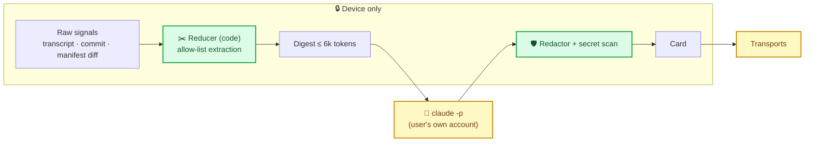

# cvprism Security and Privacy

> Status: **Phase 0 draft**. These are design commitments. Each "MUST" becomes a test at M1–M3.

cvprism watches people at work. It is useful only if users trust it with that. The design principle: **capture claims about capability, never the work itself.**

## 🚦 Captured vs never captured

| Captured (in cards) | Never captured |
| --- | --- |
| Skill and tool names (`pytorch`, `hec-ras`, `mcp-server-development`) | File contents, source code, notebooks' cells or outputs |
| Methods in market language ("Bayesian calibration of roughness coefficients") | Raw data, datasets, model weights, query results |
| Depth level (used → built → published) | Client, employer or colleague names, unless the user maps them via `profile.yaml` `projects[].display` |
| Measurable results **the user or session stated**, with units | Credentials, tokens, keys, URLs with query strings, hostnames, IPs |
| A project *alias* slug (`ctx`) | Full transcripts, prompts or diffs (never stored, never copied) |
| Opaque references (`git:<repo-alias>@<short-sha>`, hashed session ID) | Absolute file paths, usernames, repo remote URLs |

---

## 🧪 Processing boundaries



1. **Reducer (code, allow-list).** It keeps only fields on an allow-list:
   - *Claude session:* user prompts truncated to 300 chars each, tool names and counts, file *extensions* touched, package names seen in install commands, the final assistant summary (truncated).
   - *git:* commit subject, changed file extensions and counts, changed dependency *names* in manifests. No diff hunks.
   - *Watcher:* added or removed dependency names, new `SKILL.md`/`.mcp.json` server *names*, notebook kernel language.
   - Before anything leaves the reducer, the redaction rules below are applied to the digest itself.
2. **LLM call.** The digest goes to `claude -p` under whatever account is logged in on that device. That is the same provider that already saw the session, but possibly a different account. Users who need stricter handling set `capture.claude_session.enabled: false`, or use `review_mode`, or exclude paths.
3. **Redactor (after LLM).** Runs on every candidate card field.
4. **Validation.** A JSON Schema check that also enforces length caps, so no field can carry a paste of content.

---

## ✂️ Redaction hooks

`~/.cvprism/redact.yaml`, per device, never synced (it may itself contain sensitive names):

```yaml
v: 1
deny_terms:            # case-insensitive, whole-word; matched card -> term replaced, card flagged needs_review
  - "Contoso"
  - "Project Nightingale"
replace:               # literal or regex -> replacement
  - {pattern: "(?i)acme water", with: "a water utility"}
exclude_paths:         # signals from these paths are dropped before the reducer
  - "~/Documents/clients/**"
secret_scanners: [aws, gcp, github, openai, anthropic, private_key, jwt, high_entropy]
on_secret: drop        # drop | quarantine
plugins: []            # dotted paths to callables: (card: dict) -> dict | None
```

- **Secret scanning** uses built-in regexes for common key formats, plus a Shannon-entropy check on tokens ≥ 20 chars. A card that hits is dropped by default and never reaches the outbox.
- **Plugins** let organisations add their own rules (e.g. a client-list lookup) as one Python callable. Returning `None` drops the card.
- **Review mode** (`privacy.review_mode: true`) writes cards to `~/.cvprism/pending/`. `cvprism review` shows each one for approve, edit or drop before it enters the outbox.

---

## 🔑 Storage and transport exposure

| Location | Exposure | Mitigation |
| --- | --- | --- |
| Code repo (public) | Must never contain personal data | The wizard refuses vault paths inside a cvprism checkout. `.gitignore` covers `vault/`, `*.jsonl`. CI checks that no `*.jsonl` is committed outside `tests/fixtures/` |
| Private git vault repo | GitHub account compromise | Private repo. Cards contain no secrets by construction. Optional `age` encryption is on the roadmap (Open question 10) |
| Synced folder (Drive etc.) | Provider and account access | Same as above, and the user chooses the provider |
| USB drop-box | Physical loss | Spokes write only their own inbox. No full vault, profile or CV is placed on the stick by default |
| Hub vault | Full career history and profile PII | Lives on the user's main machine. Never pushed in full unless the user configures it |

### Removing data

Append-only applies to normal operation. For real mistakes (e.g. a secret slipped through):

- `cvprism suppress <id>` hides a card from merge and compile. The history is kept.
- `cvprism purge <id>` is the one deliberate exception to append-only. It rewrites the affected inbox month file on the local outbox and on every reachable transport, rewrites `cards.jsonl` on the hub, and records the ID in `vault/purged.txt`, so lagging transports are filtered at merge. For git it also prints the history-rewrite commands (`git filter-repo`) for the user to run. cvprism never force-pushes on its own.

---

## 🧱 Threat model (summary)

| Threat | In scope? | Response |
| --- | --- | --- |
| Accidental leak of client or confidential info into a CV or vault | Yes, primary | Reducer allow-list, redactor, project aliases, review mode, honesty gate |
| Fabricated claims on a CV | Yes | Citation-enforced honesty gate ([ADR-009](adr/ADR-009-honesty-gate.md)) |
| Malicious card injected via a shared transport | Partly | `vault_id` check, schema validation, ID recomputation, quarantine. No code from cards is ever executed |
| Prompt injection in session transcripts steering the extractor | Yes | The extractor runs with every tool disabled (exact `claude -p` flag pinned and tested at M2). Output is schema-validated. Content is treated as data inside delimiters |
| Hook used to run arbitrary code | Yes | Hooks call only the installed `cvprism` entry point with fixed arguments. No shell interpolation of transcript paths |
| Compromised user account or OS | No | Out of scope |
