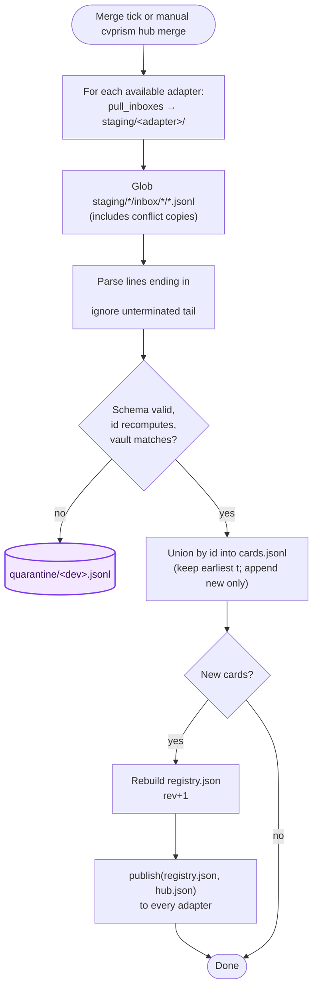

# cvprism Sync Protocol

> Status: **Phase 0 draft**. Decisions: [ADR-001](adr/ADR-001-hub-spoke-append-only.md), [ADR-004](adr/ADR-004-local-outbox.md), [ADR-005](adr/ADR-005-adapter-interface.md), [ADR-006](adr/ADR-006-syncthing-not-custom-lan.md), [ADR-012](adr/ADR-012-hub-epoch.md).

## 🧷 Invariants

The protocol is safe over every transport because of five invariants. Every adapter MUST preserve them, and the test suite checks them for each adapter.

| # | Invariant | Consequence |
| --- | --- | --- |
| I1 | A device writes only to `inbox/<own-device-id>/` on a transport | Two writers never touch the same path, so there are no write conflicts |
| I2 | Inbox files are append-only. Each record is one complete line ending in `\n` | Remote state is always a prefix (or equal) of local state, and a truncated last line is detectable |
| I3 | Card IDs are content hashes ([ADR-002](adr/ADR-002-content-hash-ids.md)) | Merging is set union. Duplicates via two routes are harmless |
| I4 | Only the hub of the highest epoch writes `registry.json`, `cards.jsonl`, `hub.json` | Hub-owned files have one writer |
| I5 | Every transport root holds `vault.json` with `vault_id`, checked before any read or write | Vaults never mix |

Because merge is a union of immutable, content-addressed records, the system is a grow-only set CRDT. Delivery order, duplication and delay do not affect the final state.

---

## 🗂️ Transport layout

Every adapter exposes the same logical tree at its transport root:

```text
<transport-root>/
├── vault.json                # {"v":1,"vault_id":"…","created":"…"}
├── hub.json                  # {"v":1,"hub_device_id":"home-pc-9a0b","epoch":1}   (hub-owned)
├── registry.json             # hub-owned, see SCHEMA.md
└── inbox/
    ├── office-01-7f3a/
    │   ├── 2026-10.jsonl
    │   └── 2026-11.jsonl
    └── lab-ws-3c1d/
        └── 2026-11.jsonl
```

On the hub, `vault/` is a superset of this tree. It adds `cards.jsonl`, `profile.yaml`, `roles/`, `market/`, `quarantine/` and `build/`. For the git adapter the transport *is* a git repo of this tree. If you want the whole vault versioned, point the hub's vault at the same repo (Open question 8).

---

## 🔌 Adapter interface

```python
class Adapter(Protocol):
    name: str
    def available(self) -> bool: ...                        # cheap probe, no side effects
    def push(self, outbox: Outbox) -> PushReport: ...       # spoke + hub: replicate own inbox files
    def pull(self) -> Registry | None: ...                  # spoke: newest registry visible at transport
    def status(self) -> AdapterStatus: ...                  # last push/pull, backlog bytes, errors
    # hub-only extensions
    def pull_inboxes(self, dest: Path) -> PullReport: ...   # copy all inbox/<dev>/*.jsonl to staging
    def publish(self, files: dict[str, Path]) -> None: ...  # write hub-owned files
```

### Push algorithm (all adapters)

```text
for file in outbox/<dev>/*.jsonl:
    local = (size, sha256)
    if cursor[adapter][file] == local: continue          # nothing new
    write remote tmp file  inbox/<dev>/.<file>.tmp       # full copy; files are small (KB–MB)
    atomic rename → inbox/<dev>/<file>                   # or adapter-native commit
    cursor[adapter][file] = local
```

Whole-file copy with an atomic rename is used instead of a remote append. It is idempotent, needs no remote locking, and synced-folder clients handle it better than in-place appends. A month file rarely exceeds 1 MB (about 2,000 cards).

### Hub pull and merge



Cards that are valid but not novel against the hub's state at merge time are kept with an extra `x_late: true` field (ADR-011). Push never shrinks a remote file: it writes the union of remote and local lines minus purged IDs, so a restored or reinstalled device cannot erase history.

The hub recomputes each `id` from the canonical fields. A mismatch means corruption or tampering, and the line is quarantined. `cards.jsonl` is append-only on the hub too, and can always be rebuilt from scratch with `cvprism hub rebuild` from all inboxes.

---

## 🧰 Adapter behaviour

| Adapter | `available()` | `push` mechanics | `pull` / `pull_inboxes` | Latency | Notes |
| --- | --- | --- | --- | --- | --- |
| **git** (default) | Remote reachable (`git ls-remote`, 5 s timeout) | Copy into a local clone at `~/.cvprism/transports/git/`, `git add inbox/<dev>`, commit, `pull --rebase`, `push`. Retry 3× on non-fast-forward | `git pull --rebase`, then read the tree | Seconds to minutes | Rebase never conflicts because paths are disjoint (I1). Sparse checkout on spokes: `inbox/<dev>/`, `registry.json`, `hub.json`, `vault.json` only. Auth is the user's own git credentials |
| **gdrive** (any synced folder) | Folder exists and `vault.json` matches | tmp + rename inside the synced folder | Read the folder | Up to the sync client (seconds to hours) | Works with Google Drive, OneDrive and Dropbox desktop clients, with no API. Conflict copies are unioned (F3). "Online-only" placeholders: the hub forces hydration by reading each file and logs a warning if one is not local |
| **usb** | A mounted volume has `<root>/cvprism-dropbox/vault.json` with matching `vault_id` | tmp + rename, then `fsync` the file and directory. Show a "safe to eject" notice | Read the drop-box when mounted | Human carry time | The watcher polls mounts every 10 s (Windows: drive letters; macOS: `/Volumes`; Linux: `/media/$USER`, `/run/media/$USER`). Flushes on mount: spokes push and pull; the hub runs `pull_inboxes` and publishes |
| **syncthing** | Syncthing REST API on `127.0.0.1:8384` answers, and the folder is shared | Plain folder writes, like gdrive | Plain folder reads | Seconds on LAN | cvprism generates the folder config and device-ID exchange instructions. It never reimplements transport ([ADR-006](adr/ADR-006-syncthing-not-custom-lan.md)). Spokes use *send-only* for `inbox/<dev>` and *receive-only* for the registry where possible |
| **local** | Folder exists | Plain folder writes | Plain folder reads | Immediate | Tests, and the hub's own captures (the hub pushes to its own vault via `local`) |

### Multiple adapters at once

A device pushes to **every** available adapter on each tick (default every 15 min, plus on-demand). Each adapter keeps its own cursor, so a card reaches the hub by whichever route arrives first. Later arrivals by other routes dedup by ID. The hub pulls from every adapter it has configured.

A spoke accepts the registry with the highest `(epoch, rev)` across all adapters, so a USB stick carrying an old registry cannot roll a spoke back.

---

## 📴 Offline and conflict scenarios

| Scenario | What happens | Final state |
| --- | --- | --- |
| S1. Spoke offline for 3 weeks | Cards append to the local outbox. `status` shows the backlog. On reconnect, every changed month file is pushed | Complete. No loss, no duplicates |
| S2. Same card sent via git **and** USB | The hub sees it twice and the union keeps one | One card |
| S3. Drive creates `2026-11 (1).jsonl` | The hub globs both. Lines in both dedup by ID | Complete |
| S4. USB yanked mid-write | The tmp file is left. The rename never happened, so the old full file is intact. Next mount: tmp is overwritten | Complete |
| S5. Drive uploads a half-written file | The hub ignores the unterminated last line and picks it up next merge | Complete, delayed |
| S6. Spoke clock wrong by +1 year | Its cards land in a future month file. Ordering cosmetics only | Complete. `doctor` warns on skew > 1 day vs git/Drive timestamps |
| S7. Hub laptop dies | `cvprism hub promote` on another device. With `epoch+1` it rebuilds `cards.jsonl` from all inboxes on all transports | Complete, except the dead hub's own unsynced cards |
| S8. Old hub comes back | Reads `hub.json` with a higher epoch, demotes itself to spoke, pushes its inbox | Complete |
| S9. Two hubs promoted concurrently (same epoch) | Tie broken by lexicographically higher `hub_device_id`. The loser demotes on next tick | Converges |
| S10. Spoke has never seen a registry | Novelty filter runs against an empty registry, so every candidate becomes a card. The hub dedups and re-checks novelty at merge (a stale card is kept but flagged `needs_review` if not novel) | Some extra cards, all correct |
| S11b. A device purges its own card | `cvprism purge <id>` rewrites its outbox and its inbox on every reachable transport, and appends the ID to `inbox/<dev>/purged.txt`. The hub unions all `purged.txt` into `vault/purged.txt` and removes the card from `cards.jsonl` and its inbox copies | Card erased everywhere the device and the hub can reach; git history needs a manual `git filter-repo` |
| S11. User wants a card gone | Inboxes stay append-only. `cvprism suppress <id>` adds the ID to hub-owned `vault/suppressed.txt` (one per line), which the merge and the compiler honour. A *correction* is a new card with `sup: [<id>]` | Card hidden from CVs, history kept |
| S12. Wrong vault's USB stick plugged in | `vault_id` mismatch. The adapter refuses and logs | No change |

---

## ⏱️ Scheduling

| Trigger | Spoke | Hub |
| --- | --- | --- |
| Timer (default 15 min) | `push` to all, `pull` registry | `pull_inboxes`, merge, publish |
| New card written | debounced `push` after 60 s | merge own inbox immediately |
| USB mount detected | push + pull | pull_inboxes + merge + publish |
| `cvprism sync` | all of the above, now | all of the above, now |
