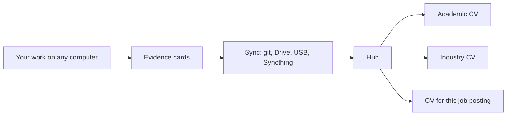

# cvprism

**Work on many machines. Get many CVs. Write none of them by hand.**

You pick up new skills nearly every day: a library, an API, a model, a field method. Your CV gets updated once a year, from memory, as one generic document. cvprism closes that gap.

- It **captures** skills, methods and measurable results from your Claude Code sessions, git commits, project files and one-line notes. It never captures code, data or file contents.
- It **deduplicates** what it already knows, so you get one card when you level up, not a hundred.
- It **syncs** cards from every computer to one hub over git, Google Drive/OneDrive/Dropbox, a USB stick or Syncthing, with no conflicts by design.
- It **builds** CVs for a role or a specific job posting as PDF, DOCX and Markdown. Every bullet cites the evidence behind it, and invented numbers are rejected by code.



## See it in 30 seconds

```bash
git clone https://github.com/sayantanonfire/cvprism.git && cd cvprism
./start.sh --name demo --role hub --vault ~/cvprism-vault --yes   # Windows: start.bat ...
cvprism demo --out ~/cvprism-demo
```

`cvprism demo` builds three role CVs and one job-tailored CV for a synthetic person, fully offline. Open `cv.pdf`, then `evidence.md` to see which card backs each bullet, and `gaps.md` to see what the job asks for that the evidence does not cover.

Next: [Getting started](guide/getting-started.md).
